# Station Wrapper 43

Make your own TV channels out of your own videos. **Station Wrapper 43** runs [FieldStation42](https://github.com/shane-mason/FieldStation42) in one Docker container and adds the pages to run it: a dashboard, a week calendar for each channel, a TV guide channel, a browser player, and an IPTV tuner that Jellyfin, Plex, VLC or TVHeadend can use.

> **Built on [FieldStation42](https://github.com/shane-mason/FieldStation42)** by shane-mason and its contributors, which does all the scheduling and cataloguing. It is run here unmodified; Station Wrapper 43 is the container, pages and tuner around it. Thank you to its authors.

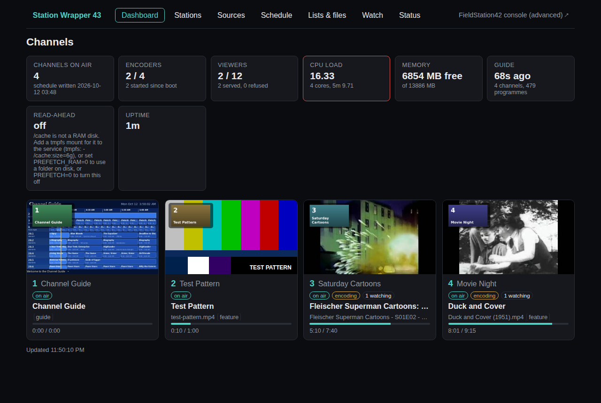

## What you get

- **Channels that run all day by themselves.** Draw a week on a calendar (cartoons in the morning, movies at night, a different lineup in summer or on a holiday), and the schedule builds and keeps itself topped up.
- **Breaks like real TV, when you want them.** Commercials and start/end "we'll be right back" cards, by default, by time of day, or per show. Or no breaks at all: videos play back to back.
- **A scrolling TV guide channel** drawn live, with every channel and what is on.
- **One lineup for everything.** Your channels, an antenna tuner, a playlist and a camera in one HDHomeRun-style lineup and one guide, with synopsis, pictures and channel logos.
- **An HDHomeRun's guide for Jellyfin.** Jellyfin cannot read an HDHomeRun's schedule itself. The container reads SiliconDust's guide for the antenna and serves it as XMLTV (listings, logos, episode details), so Jellyfin needs no Schedules Direct account. It is SiliconDust's own service, so how far ahead it lists depends on their answer for your device (a unit without their DVR subscription usually gets a short window), and it covers over-the-air in the US and Canada.
- **Easy to start.** A *Getting started* card, a **Make me a channel now** button, and templates for a cartoon channel, a mainstream channel, a movie channel and a loop.
- **Your media is never touched.** It is mounted read-only; a list is only links.

| | |
|---|---|
| 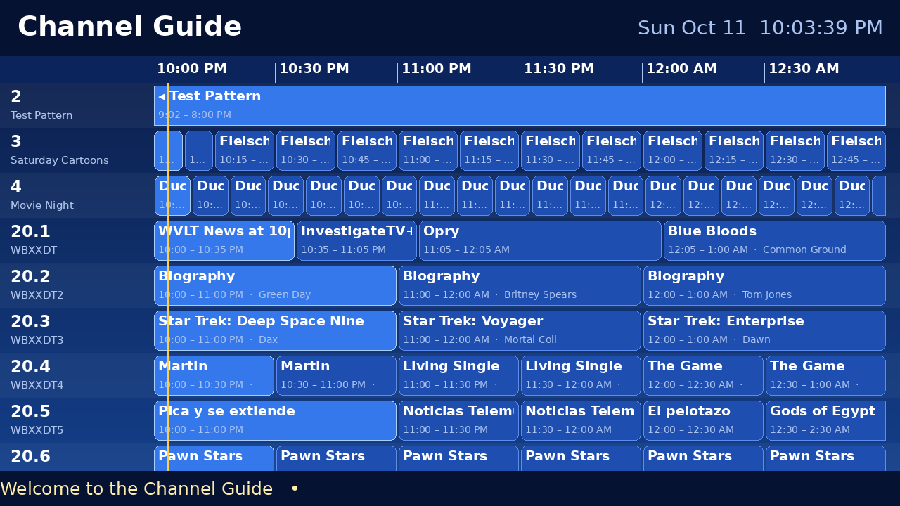 | 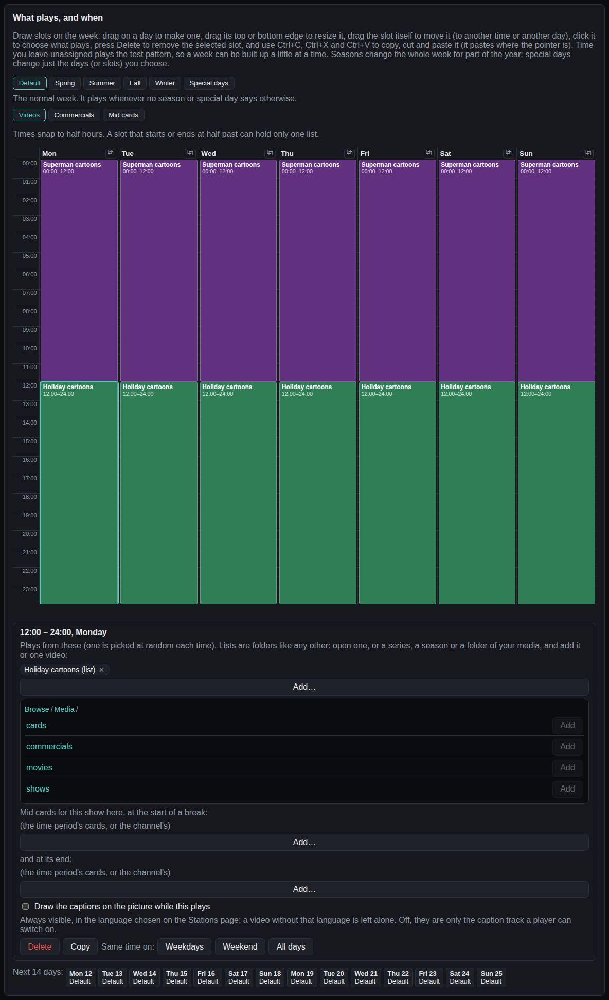 |
| The guide channel, drawn live: your channels and an antenna tuner's, with the real listings | A week on the calendar, with the one browser for what plays |

## Quick start

```
cp .env.example .env        # set FS42_LOCAL_ROOT (local disk) and FS42_MEDIA_ROOT (your videos)
./setup-dirs.sh             # creates the local layout, once
docker login ghcr.io          # only if the package is private
docker compose pull && docker compose up -d
```

Prefer to write the compose file yourself, with only some media folders mounted? [docker-compose.sample.yml](docker-compose.sample.yml) is a complete one.

Open `http://<host>:5004`. A new install already has a Channel Guide on channel 1 and a Test Pattern on channel 2; press **Make me a channel now** (or **New station**) to make the first real one. The [QUICKSTART](QUICKSTART.md) has the first ten minutes, and the [reference](docs/REFERENCE.md) has the rest.

## A short tour

| | |
|---|---|
| 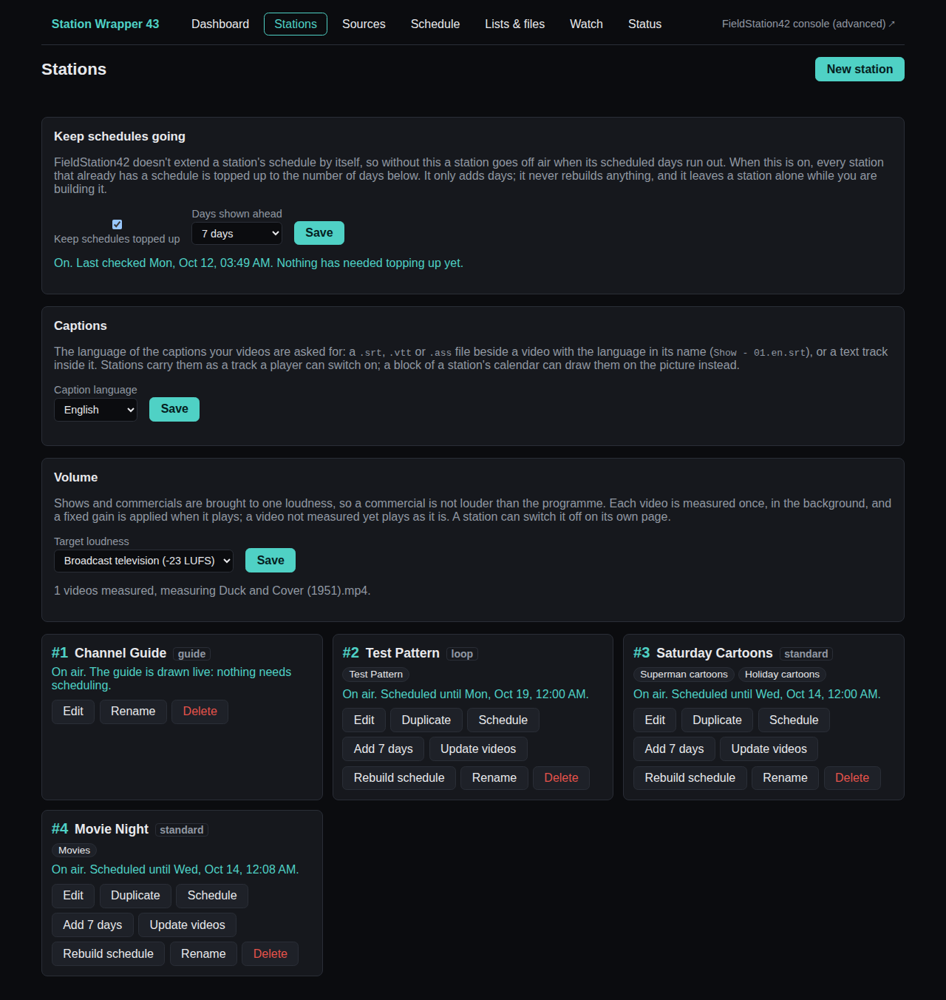 | 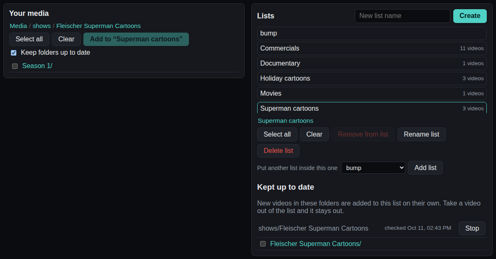 |
| **Stations**: one card per channel, build and keep it going | **Lists & files**: browse your media, make lists, or use a series directly |
| 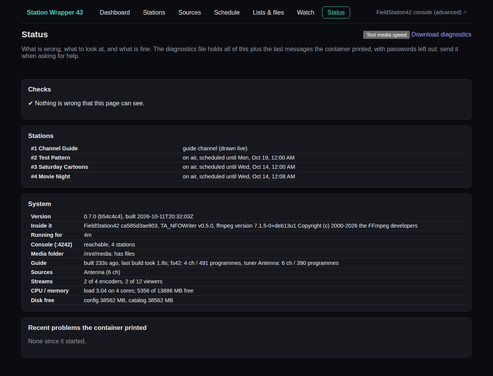 | 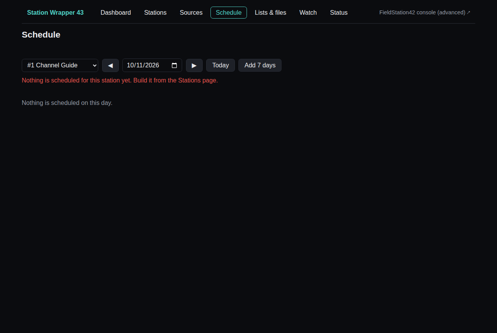 |
| **Status**: what is wrong first, with a button to fix it | **Schedule**: what plays when, down to each file in a break |
| 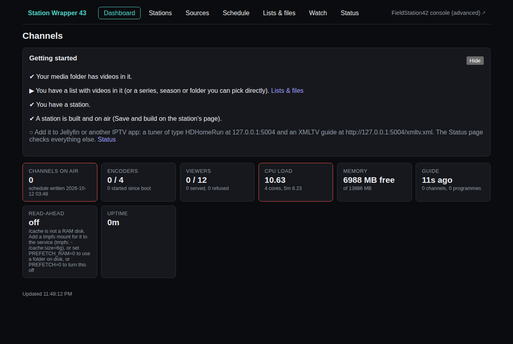 | 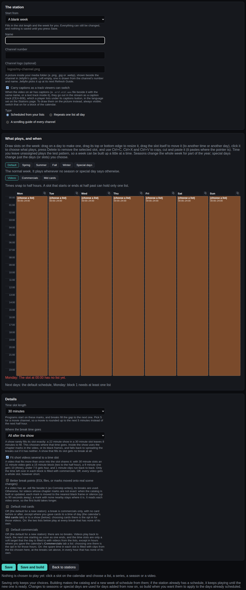 |
| **First run**: the Getting started card and a channel in one click | **New station**: start from a template, then change anything |

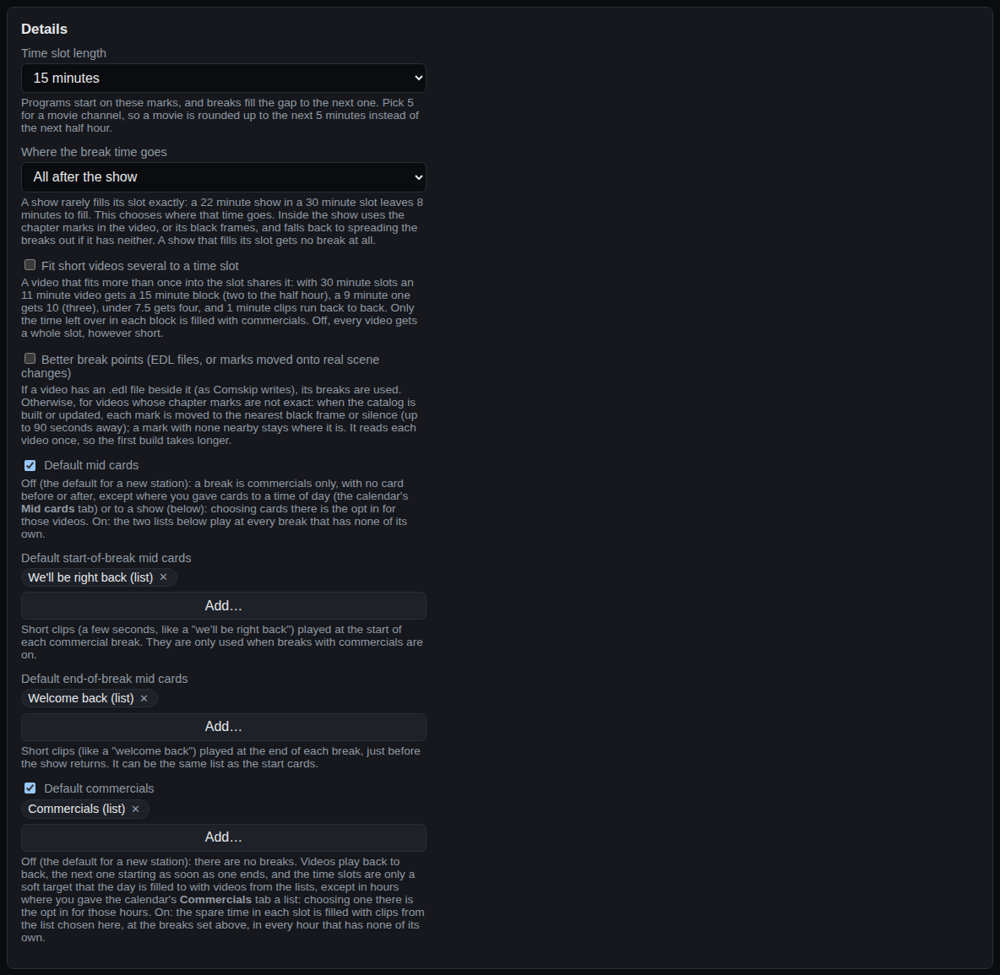

### In Jellyfin

Add the container as an HDHomeRun tuner and its `/xmltv.xml` as the guide; your channels sit beside an antenna tuner's, with logos, programme names and episode titles.

1. **Live TV → Tuner Devices → Add → HDHomeRun**: `http://<container host>:5004`.
2. **Live TV → TV Guide Data Providers → Add → XMLTV**: `http://<container host>:5004/xmltv.xml`.
3. **An antenna tuner set to *guide only*** (Sources page) brings only its listings into this guide; its video still comes from the tuner. So also add the tuner itself as a **second HDHomeRun tuner device** in Jellyfin, at its own address (`http://<tuner address>`), for its channels. It needs no guide provider of its own: its listings are already in the container's XMLTV. Set it to *proxy* instead and the container carries its channels and none of this is needed.
4. **Refresh Guide Data**, then check each tuner's channels are mapped.

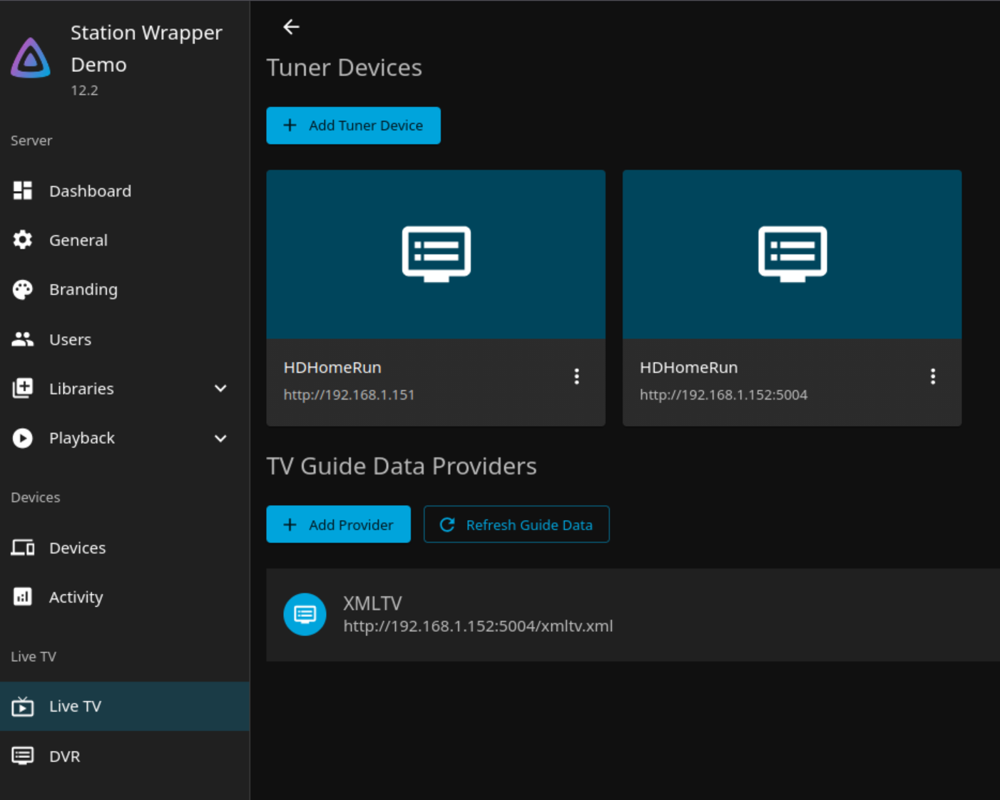

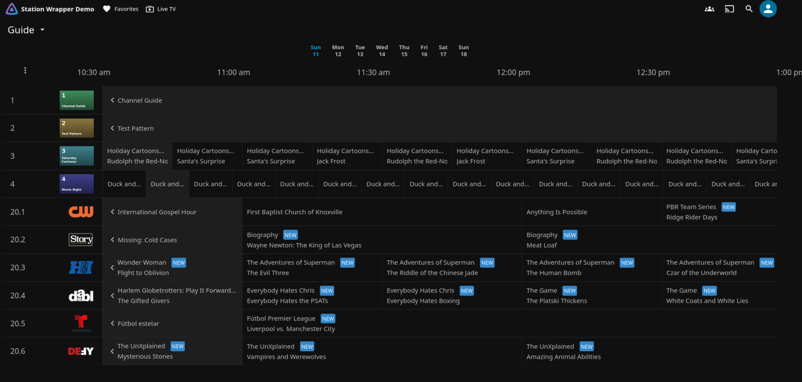

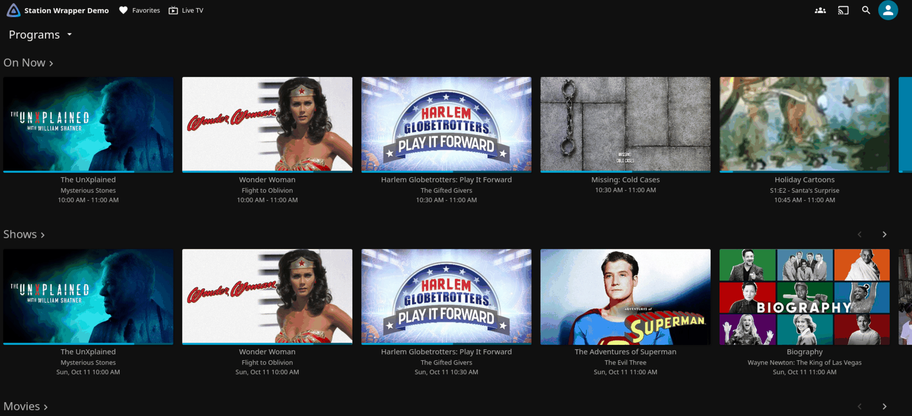

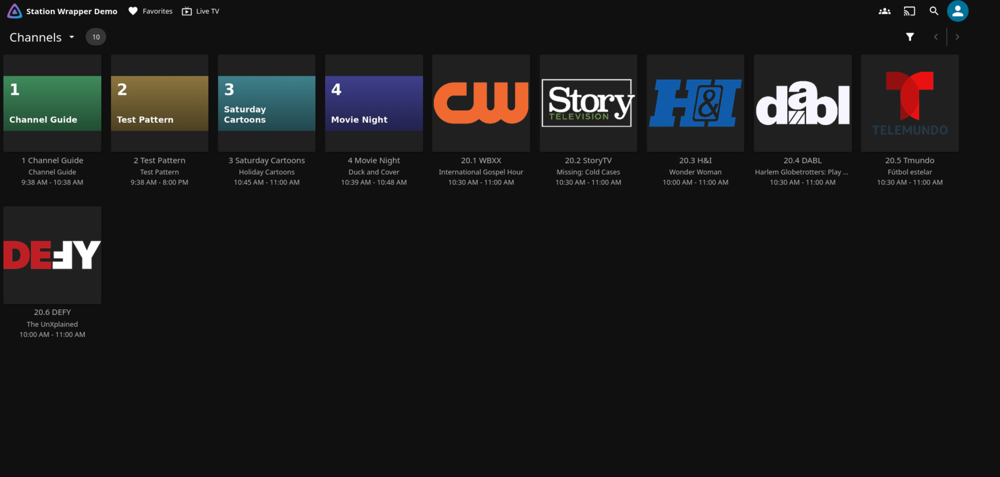

## How it works

```
                  ┌────────────────────── one container ─────────────────────────────────┐
 your media ─────>│ console :4242  ──writes──>  fs42_fluid.db  ──reads──>  tuner :5004    │──> browser, Jellyfin, VLC
 (read-only)      │ (FieldStation42)                (sqlite)               (ffmpeg, mpegts)│
                  │ + sync (optional): keeps a pool of symlinks to your media current     │
                  │ + ta-nfo (optional): a readable library of your TubeArchivist videos  │
                  └───────────────────────────────────────────────────────────────────────┘
```

A small supervisor runs these and keeps them up (it restarts one that stops, tags each log line, and stops them cleanly). **console** is FieldStation42's web console, where catalogs and schedules are built. **tuner** reads the schedule, encodes each channel once with ffmpeg, and serves the dashboard, the player, the guide and the IPTV endpoints. `docker logs <container>` shows all of them. FieldStation42 itself is vendored unmodified under `fieldstation42/src`; its behaviour is adjusted at run time by `fieldstation42/console_launch.py`.

## Documentation

- [QUICKSTART](QUICKSTART.md): the first ten minutes.
- [Reference](docs/REFERENCE.md): the volumes and settings, the login, every page, sources and antenna tuners, breaks and mid cards, the YouTube conversion, the generator, updating FieldStation42.
- [Changelog](CHANGELOG.md), [Roadmap](ROADMAP.md), [Security](SECURITY.md), [Contributing](CONTRIBUTING.md), [Notices](NOTICE), [Releasing](docs/RELEASING.md).

## License

- **This project's own code** (the wrapper, dashboard, tools and scripts) is under the [PolyForm Noncommercial License 1.0.0](LICENSE): **free for personal use** (research, hobby projects, private entertainment, study) and for other noncommercial uses the license lists. **Commercial use needs a separate agreement with the author**: contact JamesM92 through this repository.
- **FieldStation42** (the scheduling engine, in `fieldstation42/src/`) is by shane-mason and is under the **Mozilla Public License 2.0**. It is included unmodified, with its own `LICENSE`. This project's license does not apply to it.
- Everything else in the image (ffmpeg, Python and its packages, mpegts.js, TA_NFOWriter) keeps its own license.
- This is a plain-language summary, not legal advice. The `LICENSE` file is what counts.

## CI/CD

Workflows live in `.github/workflows/` and need a runner labeled `ubuntu-latest` with Docker access.

| workflow | trigger | what it does |
|---|---|---|
| `ci.yml` | push to `dev`/`main`, PR to `main` | syntax checks, every test, the FieldStation42 schema contract |
| `security.yml` | push to `dev`/`main`, PR to `main`, weekly | bandit on our code, a pip-audit of the pinned `requirements.txt`, a secret scan (detect-secrets), a Trivy scan of the repository (dependencies, secrets, the Dockerfile); a finding fails the run |
| `dev-image.yml` | push to `dev` | builds the one image, smoke-tests it (`scripts/smoke-image.sh`), then pushes `:dev` and `:dev-<short-sha>`; nothing is pushed if the smoke test fails |
| `release-image.yml` | `v*` tag | builds, smoke-tests, then pushes `:<version>` and `:latest` |
| `upstream-compat.yml` | weekly, and on demand | fetches upstream FieldStation42's latest commit into a scratch folder and runs the contract check against it; it never changes the vendored copy |
| `codeql.yml` | GitHub only | GitHub code scanning |

Developer checks that need Docker: `scripts/e2e-breaks.py` (the break settings against the real engine), `scripts/e2e-seasons.py`, and `scripts/make-screenshots.py` (the pictures in `docs/images`). `scripts/preflight.sh` runs the CI checks and a throwaway image build before a push.

The image: `ghcr.io/jamesm92/station-wrapper-43` (one image, whatever you switch on); `FS42_TAG` picks `dev` (default), `dev-<short-sha>`, or a release version. Setup, once: no secret is needed: the workflow uses GitHub's own token.

## About how this was made

**This project was written with AI.** The code, tests and documentation were produced by an AI coding assistant ([Claude Code](https://claude.com/claude-code), from Anthropic), working to the direction of its owner, who decided what it should do, ran it against real media and a real HDHomeRun tuner, and reviewed and corrected the results. It has a large automated test suite and security scans (see above), and it has been run end to end in a container, but it has not had the long soak of a mature project, and a person did not read every line. Expect rough edges, back up your configuration before upgrading, and please [report what you find](https://github.com/JamesM92/station-wrapper-43/issues).

FieldStation42, which does the scheduling, is a separate project by its own authors and is vendored here unmodified.
